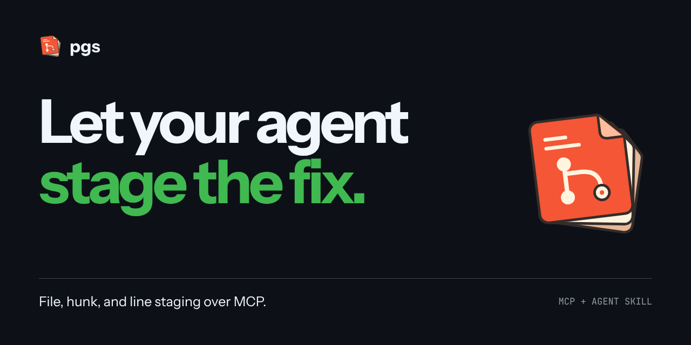

# pgs



[](https://github.com/UtsavBalar1231/pgs/actions/workflows/ci.yml)
[](https://github.com/UtsavBalar1231/pgs/releases/latest)
[](LICENSE)

**Precise Git staging for coding agents.** pgs turns a mixed working tree into
focused commits. Your agent selects whole files, individual hunks, or exact lines
through a local MCP server. A bundled skill teaches it the workflow.

[Install](#install) · [Quick start](#quick-start) · [Agent setup](docs/INTEGRATIONS.md) · [CLI guide](docs/USAGE.md) · [Launch video](media/launch/README.md)

## Commit the fix. Leave the debug line for later.

Your agent fixes an auth check and leaves a debug statement in the same hunk.
Select the fix, preview it, and commit it. The debug statement stays unstaged.

```text
src/auth.rs                         What belongs in this commit?
────────────────────────────       ─────────────────────────────
+ !token.trim().is_empty()     →    fix: reject blank tokens
+ eprintln!("debug: auth check");    stays local
```

https://github.com/user-attachments/assets/b5857677-9546-4bdc-925d-8ab0b2f0b629

<details>
<summary>Square video</summary>

https://github.com/user-attachments/assets/ee51b137-6307-4a8f-aeb8-b6f4cadf6cae

</details>

## Install

### For your coding agent

Plugin installs include the MCP server launcher and the staging skill.
The launcher downloads the matching binary on first use; no Rust toolchain is needed.

**Claude Code** — run inside Claude Code:

```text
/plugin marketplace add UtsavBalar1231/pgs
/plugin install pgs@pgs-marketplace
```

**Codex** — run in your terminal:

```bash
codex plugin marketplace add UtsavBalar1231/pgs
codex plugin add pgs@pgs-marketplace
```

**Gemini CLI**:

```bash
gemini extensions install https://github.com/UtsavBalar1231/pgs
```

Then try: **“Use pgs to inspect my changes and propose focused commits.
Show me the plan before committing.”**

Plugin launchers need `curl` and a POSIX `sh`; on Windows, use Git Bash.
[Setup for Copilot, Cursor, VS Code, and other agents →](docs/INTEGRATIONS.md)

### Other installation options

[Prebuilt binaries, source builds, verification, and cargo-binstall →](docs/INSTALL.md)

Linux, macOS, and Windows are supported. The optional standalone CLI uses the
same engine. The `pgs` name on crates.io belongs to a different project; follow
the repository's installation guide.

## Quick start

After connecting the plugin, give your agent the intent:

> Commit only the auth fix. Leave the debug statement unstaged.

Your agent uses pgs tools to carry out that request:

| Agent step | Tool | What happens |
|------------|------|--------------|
| Inspect the working tree | `pgs_scan` | The agent gets the diff, hunk IDs, and file checksums. |
| Preview its selection | `pgs_stage` with `dry_run` and `explain` | It checks that only the fix would be staged. |
| Stage the fix | `pgs_stage` | The chosen line enters the index. |
| Make the focused commit | `pgs_commit` | The fix is committed; the debug statement stays local. |
| Check what remains | `pgs_scan` | The agent verifies the unstaged debug change. |

The agent can select at the granularity the task needs:

| Select | MCP `selections` entry |
|--------|------------------------|
| A file | `src/auth.rs` |
| A hunk | A 12-hex ID from a fresh `pgs_scan` |
| Exact lines | `src/auth.rs:2-2` or `src/auth.rs:10-20` |

`pgs_unstage` removes selected changes from the index. Agents can pass
`expected_checksums` from the scan to refuse staging if a file changed.
The [bundled skill](plugins/pgs/skills/git-commit-staging/SKILL.md) teaches the
selection, planning, and commit workflow. Your agent's own approval rules still apply.

[All agent and editor integrations →](docs/INTEGRATIONS.md) ·
[Standalone CLI reference →](docs/USAGE.md)

## Built for precise, automated work

| Capability | What it gives you |
|------------|-------------------|
| File, hunk, and line selection | Focus a commit even when one file contains unrelated edits. |
| Dry-run previews | Inspect exactly what a stage or unstage operation would change. |
| Content-addressed hunk IDs | Select a named change from a fresh scan. |
| Checksum guards | Refuse a selection when a file changed after the scan. |
| Index backup and rollback | Stage and unstage operations restore the backup if an operation fails. |
| Commit plans | Validate, reconcile, and apply a sequence of focused commits. |
| CLI + 11 MCP tools + skill | Use the same engine from a shell or a coding agent. |

pgs builds index blobs directly with libgit2. The MCP server runs locally over
stdio. [How it works and how related tools compare →](docs/COMPARISON.md)

## Go further

| I want to… | Read |
|------------|------|
| Install binaries or verify a download | [Installation](docs/INSTALL.md) |
| Connect my coding agent or editor | [Integrations](docs/INTEGRATIONS.md) |
| Use selectors, drift guards, and commit plans | [CLI guide](docs/USAGE.md) |
| Parse output or handle exit codes | [CLI contract](docs/CLI_SPEC.md) |
| Configure or understand the MCP server | [MCP server](docs/MCP_SERVER.md) |
| Understand the design | [Architecture](docs/ARCHITECTURE.md) |
| Reuse the video or social assets | [Presentation kit](docs/PRESENTATION.md) |
| Contribute a change | [Contributing](CONTRIBUTING.md) |

External clean-filter programs such as git-lfs and git-crypt are refused;
stage those paths with `git add`. Partial staging also refuses non-UTF-8
content and line-ending mismatches. [Platform details and constraints →](docs/USAGE.md#platform-support)

## Development

```bash
cargo build
cargo test
cargo clippy --all-targets -- -D warnings
cargo fmt --check
```

Rust 1.88+ and a C compiler are required. The video has its own optional
[Remotion project](media/launch/README.md); it is independent of the Rust build.

[MIT license](LICENSE) · [Report a bug](https://github.com/UtsavBalar1231/pgs/issues) · [Security policy](SECURITY.md)
