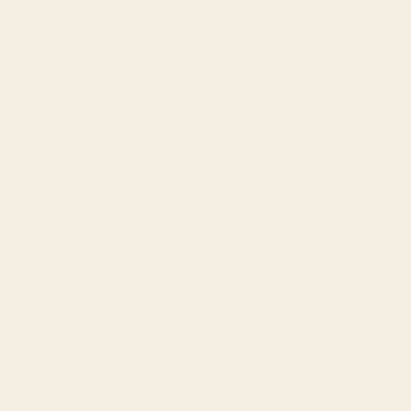

# pgs staged-patch icon

Three sheets shuffle into a patch stack. The patch header and commit path draw
in sequence; a selected patch travels into the graph and resolves into a commit
node. The final icon holds from frame 98 through frame 239.

| File | Use |
|------|-----|
| [pgs-icon.svg](pgs-icon.svg) | Scalable static artwork, transparent background. |
| [pgs-icon.png](pgs-icon.png) | 512×512 transparent PNG rendered in Skia Skottie. |
| [lottie.json](lottie.json) | Editable 512×512 animation, 60 fps, four seconds. |
| [preview.gif](preview.gif) | Looping playback preview on warm paper. |
| [preview.mp4](preview.mp4) | Four-second H.264 playback preview. |

The Lottie contains vector shapes only, with no fonts, external images, or
network dependencies. Five named color slots expose the charcoal, orange,
paper, fold, and backing colors. The JSON has a transparent background;
the preview files add warm paper for contrast. Play the Lottie once and hold
its final frame for an entrance animation. The GIF repeats the entrance.

## Source and editing

The geometry and keyframes are authored in
[`media/launch/scripts/staged-patch.mjs`](../../../media/launch/scripts/staged-patch.mjs).
Run it with Node.js from any directory. It writes an editable scene into the
official Diffusion Studio player at
`media/launch/out/skottie-player/public/projects/pgs/scene-7/lottie.json` and
export sources under `media/launch/out/staged-patch/`.

Use the official [Diffusion Studio Skottie player](https://github.com/diffusionstudio/lottie)
for editing and preview. This session verified the scene in that player,
including its transparent opening, selected-patch transfer, held final frame,
and unclipped alpha bounds. The script rebuilds the default palette; preserve
any editor color changes before regenerating.

## References and rights

Original pgs vector artwork and animation, covered by the project's MIT license.
Motion references supplied by the project owner:

- [Git Logo by MD Murad Hossain](https://lottiefiles.com/free-animation/git-logo-OTHT8AjGNe): emblem assembly and rotational settling.
- [GitHub Dark Mode by Malan Alankara](https://lottiefiles.com/free-animation/github-dark-mode-7F3nwszo5B): staggered line drawing and expressive timing.
- [Git Animation by Maryna Lytkina](https://lottiefiles.com/animation/git-animation_9768187): public preview of emblem-to-wordmark staging.

The references informed motion choices. Their source artwork is not included
in this kit; the premium reference was studied through its watermarked preview.
