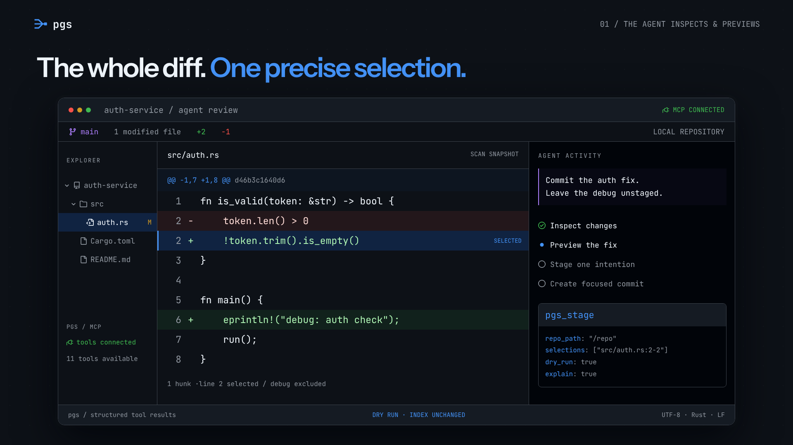

# pgs launch film

**Big ideas. Small commits.** A dark product film showing a coding agent
using pgs MCP tools to commit a fix and leave a debug statement local.

[Watch the 35-second film](../../docs/assets/pgs-launch.mp4) ·
[12-second square cut](../../docs/assets/pgs-social.mp4) ·
[Creative direction and research](CREATIVE.md)



The main film is 1920×1080, 30 fps, H.264/AAC. The social cut is 1080×1080,
12 seconds, 30 fps. Both have original synthesized sound and music, with no
voiceover. All essential information is visible with sound off.

## Edit and preview

Requires Node.js 20.19+, 22.13+, or 24+ and pnpm. FFmpeg is needed only to
regenerate the audio. The checked-in audio is ready to use.

```bash
cd media/launch
pnpm install --frozen-lockfile
pnpm dev
```

Open <http://localhost:3210/PgsLaunch>. `PgsSocial`, `SocialCard`, and the six
individual scene compositions are available in the sidebar. Frame-based
animation makes scrubbing deterministic. Press Space to play or pause.

## Export

```bash
pnpm check
pnpm verify-demo    # requires a built ../../target/debug/pgs-mcp
pnpm render        # out/pgs-launch.mp4
pnpm social-video  # out/pgs-social.mp4
pnpm social        # ../../docs/assets/social-card.png
pnpm poster        # ../../docs/assets/launch-poster.png
pnpm audio         # regenerate public/score.m4a from scripts/score.mjs
```

Run `pnpm audio` before rendering if you change the sound source. The optional
first render may download Remotion's headless Chromium browser. Final exports
are copied into `docs/assets/` for sharing; intermediate files stay in `out/`.
If Cargo uses a custom target directory, set `PGS_MCP_BINARY` to the freshly
built server's absolute path when running `pnpm verify-demo`.

`src/design.ts` owns the palette, fonts, and motion curve. Each scene owns its
layout and timing. `src/Launch.tsx` owns the edit; `src/Social.tsx` is composed
specifically for a square frame. It is not a crop of the landscape film.

[Presentation kit](../../docs/PRESENTATION.md) · [Validation](QA.md)

## Animated icon

The [staged-patch icon kit](../../docs/assets/pgs-icon/README.md) includes an
SVG, transparent PNG, self-contained Lottie JSON, and playback previews.
`scripts/staged-patch.mjs` authors the geometry and motion. It writes the
editable scene to `out/skottie-player/public/projects/pgs/scene-7/lottie.json`
and an export copy under `out/staged-patch/`. The official Skottie player is
installed separately under `out/skottie-player/` for previewing and color edits.
